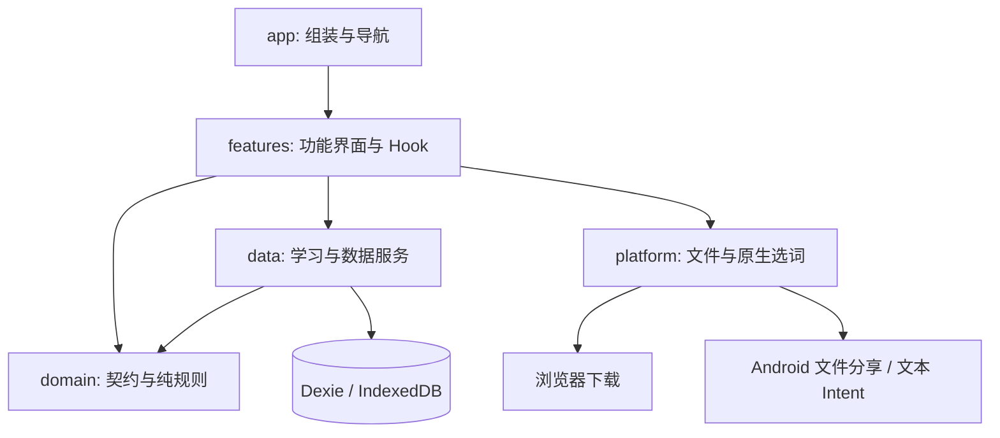

# 技术架构

## 选择与边界

使用 React + TypeScript + Vite 构建响应式中文界面，Capacitor 负责 Android 外壳。
不引入后端、账号、云数据库、全局状态框架或 AI SDK。
Dexie 包装 IndexedDB，通过事务保证答题、复习进度和草稿清理的一致性。

这是职责边界，不要求为每次读取增加无意义的包装。应用数据订阅可以直接读取数据库；
修改学习状态必须经过数据服务。原生接口集中在 platform，便于替换和浏览器测试。

## 模块职责

| 模块              | 负责                                 | 不应加入               |
| ----------------- | ------------------------------------ | ---------------------- |
| app               | 导航、布局、学习库订阅、选词事件协调 | 题目判分、备份文件解析 |
| features/practice | 连续答题、即时草稿、保存状态         | 直接修改复习算法       |
| domain            | Zod 协议、纯判题、间隔与队列规则     | React、DOM、数据库访问 |
| data              | 导入、提交、备份恢复、生词收藏       | 页面布局、原生分享 UI  |
| platform          | 浏览器与 Android 差异                | 付费 AI 请求、业务规则 |
| shared            | 通用组件、基础与布局样式             | 聚合全部业务的工具文件 |

App 与 AppShell 分离，Dashboard 与 AnswerCard 分离，答题状态抽出 useAnswerSession。
按功能放置局部样式。维护源码使用 Prettier，目标行宽 100；压缩只发生在 dist。
架构参考已有项目的分层经验，当前项目单独实现其本地学习逻辑。

## 本地数据

数据库名称 `english-pocket-v1` 是稳定标识，不在应用升级时随意更换。
初版 Dexie schema version 1 包含四张基础表：

| 表       | 主键 | 内容                               |
| -------- | ---- | ---------------------------------- |
| packs    | id   | 题包及题目内容                     |
| attempts | id   | 不可由界面改写的每次答题记录       |
| progress | key  | 复习阶段、到期时间、次数与累计错误 |
| drafts   | key  | 当前未提交答案                     |

题目 key 使用 JSON 编码的 `[packId, kind, itemId]`，避免字符串拼接碰撞。
同一个词出现在不同题包时按不同题卡记录，暂不自动合并掌握度。
生词收藏存为保留 ID `_personal-vocabulary` 的内部题包，不再增加重复的学习记录结构。
每册上限 500 词；初次练习后进入正常间隔复习。

后续改变表结构必须添加 Dexie version 升级逻辑、旧数据测试与备份格式迁移。
Android 先复用同一存储层；如果真机发现 WebView 存储限制或数据量明显增加，再评估 SQLite 适配。
未经迁移测试，不以换库作为“修复”而丢弃原记录。

## 保存与失败处理

- 输入按顺序立即写草稿，不依赖离开页面时才能完成的异步保存。
- 提交前等待当前草稿写入完成。attempt UUID 防止同一提交重试重复计数。
- 记录、进度和对应草稿清理在同一事务中提交；失败保留当前界面和答案供重试。
- 只移除与所交答案相同的草稿，保留另一窗口可能写入的新内容。
- 提交重新核对题包内容，拒绝恢复/换包后过时的练习状态。
- 完整备份在同一只读事务中读取全部表。恢复先验证结构、重复键和引用，再在单一事务中替换。
- 存储满或不可用必须报告失败，不能将内存状态伪装成已保存。

浏览器在极端断电或系统强制终止时仍可能丢失尚未完成的写入。
本地存储不等于外部备份；Web 与 Android 也不是同一个数据库空间。

## 判题与复习

拼写使用 NFKC 规范化、忽略大小写、首尾空格、连续空格与弯引号差异。
不忽略缺字、错字、连字符和其他标点；可在 acceptedAnswers 明确允许替代拼法。
选择题依据选项 ID 判定，保留原始回答。

首次答对后 1 天复习；到期再答对后依次间隔 3、7、14 天。
后续乘以约 1.7，并限制为最多 90 天。答错回到阶段 0，1 天后重练。
提前重复答对记录练习次数，但不推进阶段、不推迟原到期时间。
使用设备当地日期计算日目标，用 ISO UTC 保存时间；跨夏令时仍按日历天安排间隔。
这是可替换的启发式初版，不是经过学习效果验证的个性化模型。

每日新词上限为 10 个 CET 类词与 2 个科研词，跨题包计算；
词量不足时只展示已有词，CET-6 标签已支持但尚未提供独立课程切换。
到期复习不受新词上限限制；阅读生词可由使用者额外主动练习。
每日目标统计目前会包含额外主动学习的生词，可能超过 12，不能当成强制学习目标。

## 查词

基础科研词表为本项目原创简明释义，并与全部已导入词汇合并查询，优先展示个人题包语境。
词形候选仅作建议，不把启发式词干推断直接当作正确释义。
本地未收录时可自填，或点击打开在线词典；不自动请求网络、不上传论文、无后台剪贴板读取。

Android 插件仅接收 `ACTION_PROCESS_TEXT` 的明确选中文本，限制到 100 字符。
冷启动暂存后由 JS 消费，热启动通过事件传递。练习中接收选词会等待使用者退出，避免打断未保存答案。
该插件已按安装的 Capacitor Java 接口实现并通过 Android CI 编译，仍须真机测试。

## 离线与扩展

生产 Web 构建使用 Service Worker 预缓存本地静态资源，首次缓存完成后可离线重开。
Android 静态资源嵌入安装包。导入 JSON 不加载其中 HTML，不执行脚本，文本交给 React 转义。
文件导出在浏览器走下载，在 Android 写入 Cache 后调用系统分享。
使用者必须将备份另存至 App 之外；Cache 中的临时分享副本不是安全备份位置。

后续新增题型使用带 type 的区分联合和版本化导入协议，不向已有 choice 题目任意加字段。
听力音频需要独立资源清单和许可信息。翻译/作文为人工批改状态，不冒充自动准确评分。
未来 AI 仅在需求明确后增加独立适配器，不把私钥写进前端或公开仓库。

## 官方依据

- [Vite 入门](https://vite.dev/guide/)
- [Capacitor 8 环境](https://capacitorjs.com/docs/getting-started/environment-setup)
- [Dexie 事务](<https://dexie.org/docs/Dexie/Dexie.transaction()>)
- [Capacitor 文件系统](https://capacitorjs.com/docs/apis/filesystem) 与 [分享](https://capacitorjs.com/docs/apis/share)
- [Android Intent API](https://developer.android.com/reference/android/content/Intent#ACTION_PROCESS_TEXT)

## 听力扩展

听力采用 schema version 2 增加材料、媒体、题目、作答、进度、草稿与备注表，保持原数据库名称和四张表。
原题身份独立于每日题包，复用同一复习算法；听力界面放 features/listening，数据服务放 data/listening。
媒体与纯 JSON 分开。完整迁移支持带 WAV 的受限 ZIP STORE，轻量 JSON 明确不含音频。
详细协议、事务边界、限制与验证范围见 [LISTENING.md](LISTENING.md)。

## 手机导航与原位查词（0.3）

features/reading 只提供题后文本入口与释义浮层，不再有独立查词路由。
ReadableText 的 enabled 在原题提交成功前为 false，前台不会生成查询按钮。
v2 可选 glossary 使用现有 Word 契约，但不加入练习队列，旧 v1 和旧备份仍可读取。
无听力库但有 v2 题包时，备份也必须用 v2，避免丢失或拒绝语境词数据。

platform/backNavigation 和 domain/BackActions 分离原生桥接与返回优先级。
AndroidX 回调仅在有可返回层时启用；提交期间保持拦截，等待已有草稿事务完成才关闭练习。
页面空白处的横滑走同一返回操作，输入控件、播放器、弹层和纵向滚动不抢手势。
不承诺自定义预测返回动画，系统两侧边缘行为需对应 Nothing 版本真机验收。

IncomingFilesPlugin 仅处理用户交来的本地 content URI 或分享文本，在后台限量读取 UTF-8 JSON。
不申请整盘读取权限、不请求网络 URL。data/intake 负责格式预览；确认后调用已有导入事务。
外部文件在练习中到达会等待退出，备份不能伪装成题包自动恢复。

## 拓展题型（0.4）

v3 题包在 v2 上增加 written 区分联合，domain/written 定义与判分，data/written 管理事务，
features/written 负责题型列表、答题和串行草稿。学习台入口复用现有选择题/听力组件，不增加底部栏目。
数据库 version 3 只新增三表，不更改名称与原表。选词/匹配整篇调用 nextSchedule，
作文/翻译 correct=null，只有待批改作答、没有伪评分进度。
备份 version 3 保存全部记录并验证引用和重算评分，兼容 v1/v2 的显式恢复；媒体 ZIP 沿用现有适配。
完整契约见 [CET_EXPERIENCE.md](CET_EXPERIENCE.md)。

## 每日流程与候选版整理

domain/daily定义三选二日历与daily元数据；dailyPlan组织六项任务，dailyTasks计算阅读/翻译完成，
dailyListening负责校考优先与音轨选择。均不依赖React/DOM或执行写入。
Dashboard与DailyTaskCard展示顺延状态；StudySessionView通过StudyActivity复用原有练习组件；
usePlatformInbox集中原生桥接，不让App继续堆积平台副作用。
范文随Pack.daily保存，不新增数据库；每日完成从保存的attempt推导，不引入第二份完成标记。
完整规则见[DAILY_WORKFLOW.md](DAILY_WORKFLOW.md)。

## 新词先学后练

每日新词使用独立的word-study活动，WordStudySession与useWordStudy负责词义阶段，
过完本组后复用原Practice拼写界面。复习、错题和阅读入口仍直接练习。
data/wordStudy检查词汇与当前题包一致，在原drafts表保存可选wordStudy元数据
（version=1、viewedAt）；不创建答题记录或改动progress，不需要数据库结构升级。
按词确认成功后才前进，重开从第一个未确认的词继续；已过完直接提示进入拼写。
saveAnswerDraft在事务中合并已有学习元数据；拼写提交沿用原事务和草稿清理规则。
备份携带学习草稿，继续支持旧v1/v2/v3备份。新增元数据带自身版本，关联必须为单词；
含此元数据的备份需用1.1.2及以上应用恢复，旧应用会在校验时拒绝未知字段。

## 阅读导航与词汇日期分组（1.2）

范文列表与EssayReader是独立页面，domain/essays统一组织每日范文与已提交作文参考，
条目使用题包、来源和范文ID区分，未提交作文不暴露参考内容。
AppShell的useScrollRestoration按页面标识记忆滚动位置，等待懒加载内容高度就绪后恢复；
新练习仍从顶端打开。位置只在本次运行内保存，左右滑与系统返回复用既有返回分发。
domain/vocabularyGroups按首次实际拼写attempt的本地日期派生折叠分组，不使用题包日期或最后复习日期。
无attempt的旧progress归入“学习日期未记录”，无学习记录归入“未学习”，不猜测日期，也不改写记录。
本轮不新增数据库表或备份字段。全局CSS变量与Android资源同步采用中性色。
